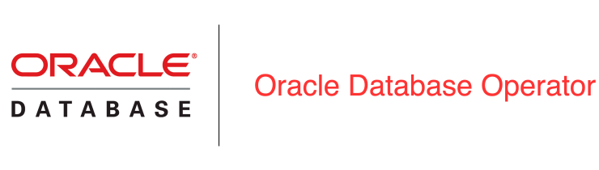

> # ⚠️ **Development Branch** ⚠️
>
> This branch contains active development for the following controllers:
>
> * **OrdsSrvs**
> * **Observability**
> * **Multitenant**
>
> **Not for production use.**
>
> * [OrdsSrvs Controller](./docs/ordsservices/README.md)
> * [Observability Controller](./docs/observability/README.md)
> * [Multitenant Controller](./docs/multitenant/README.md)

<div align="center">
<h1 align="center">
  <br>
  
</h1>
</div>

<div align="center">
<p align="center">
    <a href="https://github.com/oracle/oracle-database-operator">
    
    </a>
    <a href="https://www.oracle.com/database/kubernetes-for-container-database">
    
    </a>
</p>
</div>

<div align="center">
<p align="center">
    <a href="https://github.com/oracle/oracle-database-operator/commits/main/">
    
    </a>
    <a href="https://github.com/oracle/oracle-database-operator/issues">
    
    </a>
    <a href="https://github.com/oracle/oracle-database-operator/pulls">
    
    </a>
</p>
</div>

# Oracle AI Database Operator for Kubernetes

The Oracle AI Database Operator, formerly known as the Oracle Database Operator, extends the Kubernetes API with custom resources and controllers for provisioning, managing, and automating the lifecycle of Oracle Database workloads and associated services on Kubernetes.

It enables database teams, platform engineers, DevOps teams, and GitOps workflows to manage Oracle databases through declarative resources and standard Kubernetes tooling, improving operational consistency across environments.

Use this repository to install and verify the operator, then follow the controller-specific guides to deploy and manage database workloads. The repository also provides examples, configuration references, and operational guidance for development and production environments.

> **Important:**
>
> Start with [Prerequisites](#prerequisites), choose one installation method, verify the operator installation, and then follow the guide for the controller or workload you want to deploy.

## Contents

- [What's new](#whats-new)
- [Supported releases](#supported-releases)
- [Platform compatibility](#platform-compatibility)
- [Prerequisites](#prerequisites)
- [Quick start](#quick-start)
- [Install the operator](#install-the-operator)
- [Upgrade the operator](#upgrade-the-operator)
- [Verify installation](#verify-installation)
- [Choose your guide](#choose-your-guide)
- [Advanced installation and scope management](#advanced-installation-and-scope-management)
- [Uninstall the operator](#uninstall-the-operator)
- [Contributing](#contributing)
- [Help](#help)
- [Security](#security)
- [Troubleshooting](#troubleshooting)
- [License](#license)

## What's new

### v2.3.0
Version 2.3.0 focuses on controller lifecycle improvements, Agent Factory support,
Data Guard and SIDB fixes, observability enhancements, and updated build tooling.

| Controller / area | 2.3.0 highlights |
| --- | --- |
| [**AgentFactory**](./docs/agentfactory/README.md) *(new)* | Introduced the Oracle AI Database Private Agent Factory controller with workload lifecycle management, inbound and outbound TLS handling, certificate rotation, and status tracking. |
| **DataguardBroker** | Fixes for topology validation, authentication-wallet handling, fast-start failover (FSFO) observer management, operation tracking, and idempotent manual switchover. |
| [**SingleInstanceDatabase**](./docs/sidb/README.md) | Fixes and improvements for Data Guard prerequisites, TCP with TLS (TCPS) and TrueCache, clone/restore, external PVCs, pod security, resource handling, recreation checks, and connection status. |
| **Monitoring and Observability** *(preview)* | Enhanced secure operator metrics, DatabaseObserver readiness and ownership handling, observability RBAC, and the [Oracle AI Database Operator Observability Helm chart](./charts/oracle-database-operator-observability/README.md) for Grafana Alloy metrics and logs. |
| **Oracle Connection Manager (CMAN)** *(preview)* | CMAN endpoints, generated rules, file-mode `cman.ora` configuration, and endpoint status through the `network.oracle.com/v4` API. |
| **Multitenant controllers (LREST / LRPDB)** | Improved internal communication and configuration handling, application-user creation from Kubernetes Secrets, pluggable database (PDB) initialization monitoring, bitmask status handling, and `tnsnames.ora` topology loading. |
| **Other database controllers** | Continued lifecycle, storage, networking, reconciliation, and validation improvements across Autonomous Database, ACD, Backup/Restore, Oracle Restart, ORDS Services, RAC, and ShardingDatabase controllers. |
| **Build and installation tooling** | Updated the build toolchain to Go `1.27.4` and the documented cert-manager installation to `v1.21.2`. |
| **Operator platform** | Expanded RBAC and webhook coverage, compatibility webhooks, network policy, hardened manager security context, and updated samples and test coverage. |

## Supported releases

Review the [Oracle AI Database Operator releases page](https://github.com/oracle/oracle-database-operator/releases) for the currently supported releases, release-specific features, fixes, support timelines, and upgrade guidance.

The releases page also identifies retired or deprecated releases. Do not start new deployments on a retired or deprecated release. Keep the operator on the current supported release so that you receive the latest controller fixes, security updates, compatibility changes, and support tooling.

Oracle AI Database Operator follows a quarterly release cadence. Each quarterly release provides the maintained operator platform, supported controllers, required webhooks and RBAC updates, installation and upgrade artifacts, documentation, samples, and applicable fixes for the supported release line.

Before installing or upgrading, verify the release notes for the target version and confirm that the required Kubernetes platform, cert-manager version, database images, OCI integrations, and controller-specific prerequisites are compatible. Use version-matched manifests, CRDs, and samples, and consult the documentation for that release.

## Platform compatibility

This production release has been installed and tested on the following platforms. The general minimum Kubernetes version is 1.33; the Oracle RAC exception is described below.

| Platform | Version |
| --- | --- |
| [OCI Kubernetes Engine (OKE)](https://www.oracle.com/cloud-native/container-engine-kubernetes/) | Supported Kubernetes versions listed by the current release |
| [Red Hat OpenShift](https://www.redhat.com/en/technologies/cloud-computing/openshift) | 4.21 or later |
| [Oracle Linux Cloud Native Environment (OCNE)](https://docs.oracle.com/en/operating-systems/olcne/) | 2.3 or later; the Oracle RAC controller has an OCNE 1.9 compatibility path |
| [Google Kubernetes Engine](https://cloud.google.com/kubernetes-engine/docs) | Supported Kubernetes versions listed by the current release |
| [Azure Kubernetes Service](https://azure.microsoft.com/en-us/services/kubernetes-service/) | Supported Kubernetes versions listed by the current release |
| [Amazon Elastic Kubernetes Service](https://aws.amazon.com/eks/) | Supported Kubernetes versions listed by the current release |
| [Red Hat OKD](https://www.okd.io/) | Supported Kubernetes versions listed by the current release |
| [Minikube](https://minikube.sigs.k8s.io/docs/) | v1.39.0 or later |

Always confirm that the Kubernetes version, storage provider, container runtime, and platform-specific security policies are compatible with the operator release you are installing.

## Prerequisites

At a minimum, prepare the following:

- A supported Kubernetes cluster and a configured `kubectl` client
- Sufficient worker-node CPU, memory, and disk capacity
- Persistent storage and a usable `StorageClass` when deploying database workloads
- Access to Oracle Container Registry or a compatible private image registry
- Required image-pull and database credential secrets
- A compatible [cert-manager](https://cert-manager.io/) installation
- RBAC permissions for the selected installation method and controller

### Install cert-manager

The operator uses admission webhooks to validate user input before persisting it in `etcd`. Webhooks require TLS certificates that are generated and managed by cert-manager.

Install a cert-manager version compatible with your Kubernetes platform:

```sh
kubectl apply -f https://github.com/cert-manager/cert-manager/releases/download/v1.21.2/cert-manager.yaml
```

> **OCNE note:** Before installing cert-manager on an OCNE cluster, review the [cert-manager supported releases](https://cert-manager.io/docs/releases/) and choose a cert-manager version that supports the Kubernetes version provided by your OCNE release. OCNE 1.9 uses Kubernetes 1.29 and is supported only for the Oracle RAC controller with the OCNE 1.9-compatible RAC configuration described in [the RAC guide](./docs/rac/README.md). All other controllers require the general Kubernetes 1.33 minimum. Replace the cert-manager version in the example above with a Kubernetes 1.29-compatible release when using this RAC exception.

## Quick start

> **Important:**
>
> This quick start uses the recommended namespace-scoped YAML installation. Complete [Prerequisites](#prerequisites) before proceeding.

1. Install [cert-manager](#install-cert-manager), which provides the webhook TLS certificates.
2. Generate manifests for the operator namespace and each namespace the operator should watch:

   ```bash
   WATCH_NAMESPACE="oracle-database-operator-system,<additional-watched-namespace>"
   scripts/generate-namespace-install.sh "${WATCH_NAMESPACE}"
   ```

3. Apply RBAC first, followed by the operator system manifest to create the CRDs, webhooks, services, certificates, network policy, and operator Deployment:

   ```bash
   kubectl apply -f dist/install/oracle-database-operator-rbac.yaml
   kubectl apply -f dist/install/oracle-database-operator-system.yaml
   ```

4. Verify the operator ServiceAccount permissions in each watched namespace. The `-n`/`--namespace` option accepts one namespace only, so run the check separately for every namespace:

   ```bash
   WATCH_NAMESPACE="oracle-database-operator-system,<additional-watched-namespace>"
   for namespace in $(printf '%s' "${WATCH_NAMESPACE}" | tr ',' ' '); do
     echo "Checking ${namespace}"
     kubectl auth can-i list lrpdbs.database.oracle.com \
       --as=system:serviceaccount:oracle-database-operator-system:oracle-database-operator-controller-manager \
       -n "${namespace}"
   done
   ```

5. [Verify the operator installation](#verify-installation).
6. Choose a workload from [Supported Controllers and Charts](#supported-controllers-and-charts).
7. [Apply a Controller Resource](#apply-a-controller-resource) in a namespace watched by the operator.

> **Warning:**
>
> Do not use Quick Start to modify an existing installation or change installation scope. Use [Advanced installation and scope management](#advanced-installation-and-scope-management) instead.

### Apply a controller resource

The operator deployment starts the controllers. To use a specific controller, apply a custom resource for that controller in a namespace the operator watches. Use the guide in the [Supported Controllers and Charts](#supported-controllers-and-charts) table to choose the correct sample and prerequisites.

For example, after completing the Single Instance Database prerequisites and granting access to the target namespace, apply a Single Instance Database resource:

```sh
kubectl apply -f config/samples/sidb/singleinstancedatabase.yaml
```

Then watch the resource status in that namespace:

```bash
WATCH_NAMESPACE="oracle-database-operator-system,<additional-watched-namespace>"
TARGET_NAMESPACE="<watched-namespace>"
kubectl get singleinstancedatabase -n "${TARGET_NAMESPACE}"
```

## Install the operator

The operator can be installed through YAML manifests, the OKE add-on, OperatorHub.io, or the Red Hat OpenShift catalog.

Choose one installation method and follow only the instructions for that method. Do not combine repository YAML manifests with an add-on or catalog-based installation.

If you already installed the operator by applying the YAML files in the [Quick start](#quick-start), you can continue directly to [Supported Controllers and Charts](#supported-controllers-and-charts).

### Choose an installation method

| Installation method | Recommended for |
| --- | --- |
| [YAML manifests](docs/installation/INSTALLATION_METHODS.md#install-from-yaml-manifests) | Standard Kubernetes and GitOps installations |
| [OKE add-on](docs/installation/INSTALLATION_METHODS.md#install-as-an-oke-add-on) | OKE clusters managed through OCI |
| [OperatorHub.io](docs/installation/INSTALLATION_METHODS.md#install-from-operatorhubio) | Kubernetes platforms using Operator Lifecycle Manager |
| [Red Hat OpenShift catalog](docs/installation/INSTALLATION_METHODS.md#install-on-red-hat-openshift) | OpenShift installations using the Red Hat catalog |
| [Manual build](docs/installation/INSTALLATION_METHODS.md#build-and-deploy-a-custom-operator-image) | Environments requiring a custom operator image |

For the selected method, follow the linked [Installation Methods](docs/installation/INSTALLATION_METHODS.md) guide. It contains the namespace and cluster-scope procedures, channel-specific installation instructions, custom-image guidance, and installation verification steps.

| Situation | Recommended path |
| --- | --- |
| New namespace-scoped installation | [Quick start](#quick-start) |
| Existing installation or scope change | [Advanced installation and scope management](#advanced-installation-and-scope-management) |
| OKE cluster | [OKE add-on installation](docs/installation/INSTALLATION_METHODS.md#install-as-an-oke-add-on) |
| OpenShift cluster | [Red Hat OpenShift installation](docs/installation/INSTALLATION_METHODS.md#install-on-red-hat-openshift) |
| Custom operator image | [Manual build guide](docs/installation/INSTALLATION_METHODS.md#build-and-deploy-a-custom-operator-image) |

## Upgrade the operator

For upgrade prerequisites, CRD and controller updates, installation-channel procedures, and validation commands, see [Upgrade the Oracle AI Database Operator](docs/installation/UPGRADE.md).

## Verify installation

After installing from the repository YAML manifests, verify that the operator Deployment is available:

```bash
kubectl rollout status deployment/oracle-database-operator-controller-manager \
  -n oracle-database-operator-system --timeout=300s

kubectl get pods -n oracle-database-operator-system
```

For complete Deployment, RBAC, CRD, webhook, log, and event checks, see [Verify the installation](./docs/installation/INSTALLATION_METHODS.md#verify-installation).

These checks validate the operator installation. They do not verify the health of a database or other workload. Use the relevant controller guide for workload verification.

## Choose your guide

After the operator is installed, continue with the guide for your workload:

### Supported controllers and charts

**Kubernetes documentation:** [Kubernetes Documentation](https://kubernetes.io/docs/home/)

| Controller | Primary use case | Common operations | Guide | Supported Documentation |
| --- | --- | --- | --- | --- |
| Autonomous Database | Manage Oracle Autonomous AI Database resources on OCI | Provision, bind, start, stop, scale, backup, restore, failover | [docs/adb/README.md](./docs/adb/README.md) | [Autonomous Database](https://docs.oracle.com/iaas/Content/Database/Concepts/adboverview.htm) |
| Autonomous Container Database | Manage Autonomous Container Database infrastructure | Provision, bind, restart, terminate | [docs/adb/ACD.md](./docs/adb/ACD.md) | [Autonomous Database](https://docs.oracle.com/iaas/Content/Database/Concepts/adboverview.htm) |
| Single Instance Database and Data Guard | Manage containerized Oracle single instance databases | Provision, patch, clone, Data Guard, standby role conversion, ORDS, PDB operations | [docs/sidb/README.md](./docs/sidb/README.md) | [Oracle Database documentation](https://docs.oracle.com/en/database/oracle/oracle-database/26/) · [Data Guard Concepts and Administration](https://docs.oracle.com/en/database/oracle/oracle-database/26/dgbkr/) |
| Oracle Globally Distributed AI Database (GDD) | Manage Oracle Globally Distributed AI Database resources | Provision topology, add shards, remove shards, Raft replication | [docs/sharding/README.md](./docs/sharding/README.md) | [Oracle Sharding documentation](https://docs.oracle.com/en/database/oracle/oracle-database/26/shard/) |
| Multitenant | Manage CDB/PDB lifecycle | Create, plug, unplug, clone, open, close, delete | [docs/multitenant/README.md](./docs/multitenant/README.md) | [Multitenant Administrator's Guide](https://docs.oracle.com/en/database/oracle/oracle-database/26/multi/) |
| Oracle Base Database Service | Manage Oracle Base Database Service resources on OCI | Provision, scale, clone, backup, restore, patch, Data Guard | [docs/dbcs/README.md](./docs/dbcs/README.md) | [Base Database Service](https://docs.oracle.com/iaas/Content/Database/Concepts/overview.htm) · [OCI CLI documentation](https://docs.oracle.com/iaas/Content/API/SDKDocs/cliinstall.htm) |
| ORDS Services | Manage ORDS service deployments | Provision, update, delete | [docs/ordsservices/README.md](./docs/ordsservices/README.md) | [Oracle REST Data Services](https://docs.oracle.com/en/database/oracle/oracle-rest-data-services/) · [Kubernetes Deployments](https://kubernetes.io/docs/concepts/workloads/controllers/deployment/) |
| Oracle RAC | Manage Oracle Real Application Clusters | Provision, scale, add or remove ASM disks | [docs/rac/README.md](./docs/rac/README.md) | [Oracle RAC documentation](https://docs.oracle.com/en/database/oracle/oracle-database/26/racad/) · [Kubernetes Storage](https://kubernetes.io/docs/concepts/storage/) |
| Oracle Restart | Manage Oracle Restart deployments | Provision, ASM disk operations, load balancer support | [docs/oraclerestart/README.md](./docs/oraclerestart/README.md) | [Oracle Restart documentation](https://docs.oracle.com/en/database/oracle/oracle-database/26/adrac/) · [Kubernetes Storage](https://kubernetes.io/docs/concepts/storage/) |
| Private AI | Manage Oracle Private AI Services Container | Deploy, scale, configure networking, manage runtime updates | [docs/privateai/README.md](./docs/privateai/README.md) | [Oracle Private AI Services Container](https://docs.oracle.com/en/database/oracle/oracle-database/26/prvai/oracle-private-ai-services-container.html) |
| Oracle AI Database Private Agent Factory | Deploy Oracle AI Database Private Agent Factory services with Oracle Database connectivity | Provision schema, configure database connectivity, manage storage, scale, secure access, and update runtime settings | [docs/agentfactory/README.md](./docs/agentfactory/README.md) | [Kubernetes Deployments](https://kubernetes.io/docs/concepts/workloads/controllers/deployment/) · [Kubernetes Storage](https://kubernetes.io/docs/concepts/storage/) |
| Oracle Connection Manager (CMAN) | Route database listener traffic | CMAN for Oracle listener connectivity | [docs/cman/README.md](./docs/cman/README.md) | [Oracle Connection Manager](https://docs.oracle.com/en/database/oracle/oracle-database/26/netag/components-oracle-net-services.html) · [Kubernetes Services](https://kubernetes.io/docs/concepts/services-networking/service/) |
| Oracle AI Database Operator Observability chart | Collect operator metrics and logs with Grafana Alloy and forward them to customer-managed Prometheus-compatible metrics and Loki log backends | Helm install, TLS, RBAC, backend configuration, and telemetry verification | [Chart README](./charts/oracle-database-operator-observability/README.md) | [Prometheus](https://prometheus.io/docs/) · [Grafana Alloy](https://grafana.com/docs/alloy/) · [Grafana Loki](https://grafana.com/docs/loki/latest/) · [Helm](https://helm.sh/docs/) · [Kubernetes monitoring](https://kubernetes.io/docs/tasks/debug/debug-cluster/resource-usage-monitoring/) |


### Deploy a controller resource

Installing the operator starts the controller components. A controller begins managing a workload only after its corresponding custom resource is created.

Review the controller-specific prerequisites and sample manifest before applying a resource.

For example, after completing the Single Instance Database prerequisites:

```bash
WATCH_NAMESPACE="oracle-database-operator-system,<additional-watched-namespace>"
TARGET_NAMESPACE="<watched-namespace>"
kubectl apply -f config/samples/sidb/singleinstancedatabase.yaml
kubectl get singleinstancedatabase -n "${TARGET_NAMESPACE}"
```

### Supporting services

- [Oracle Database Observability](./docs/observability/README.md) — Database-level monitoring and exporter guidance
- [Oracle AI Database Operator Metrics with Observability Chart](./charts/oracle-database-operator-observability/README.md) — Operator metrics and logs through Grafana Alloy

## Advanced installation and scope management

| Scope-management task | Procedure |
| --- | --- |
| Update an existing namespace-scoped installation | [Updating an Existing Namespace-Scoped Installation](./docs/installation/OPERATOR_SCOPE_MANAGEMENT.md#updating-an-existing-namespace-scoped-installation) |
| Add namespaces to `WATCH_NAMESPACE` | [Adding Namespaces to the Watch List](./docs/installation/OPERATOR_SCOPE_MANAGEMENT.md#adding-namespaces-to-the-watch-list) |
| Remove namespaces from `WATCH_NAMESPACE` | [Removing Namespaces from the Watch List](./docs/installation/OPERATOR_SCOPE_MANAGEMENT.md#removing-namespaces-from-the-watch-list) |
| Verify ServiceAccount permissions in watched namespaces | [Verify namespace permissions](./docs/installation/OPERATOR_SCOPE_MANAGEMENT.md#verify-namespace-permissions) |
| Switch from namespace scope to cluster scope | [Switching to a Cluster-Scoped Installation](./docs/installation/OPERATOR_SCOPE_MANAGEMENT.md#switching-to-a-cluster-scoped-installation) |
| Verify cluster-scoped access | [Verifying Cluster-Scoped Access](./docs/installation/OPERATOR_SCOPE_MANAGEMENT.md#verifying-cluster-scoped-access) |

> **Important:**
>
> Do not update only `WATCH_NAMESPACE`. Every namespace in the watch list must also have a manager `RoleBinding` for the existing operator ServiceAccount. For an existing installation, follow the in-place procedure instead of applying a complete generated manifest from a different operator version.

For an overview of all installation and administration documents, see [Installation Documentation](docs/installation/README.md).

## Uninstall the operator

Uninstall the operator in the reverse order of installation. Before removing the operator Deployment or CRDs, decide whether managed custom resources and database storage should be retained or deleted.

### 1. Delete custom resources

Delete custom resources before deleting the operator Deployment or CRDs so that controller finalizers can run and clean up resources created by the operator.

Review operator resources in a namespace:

```sh
kubectl api-resources --verbs=list --namespaced -o name \
  | grep -E 'database.oracle.com|observability.oracle.com|privateai.oracle.com|network.oracle.com'
```

Delete only the resources you no longer need:

```sh
kubectl delete <resource-name> --all -n <namespace>
```

For namespace-scoped installations, repeat this process in every namespace listed in `WATCH_NAMESPACE`.

### 2. Remove the operator installation

Use the uninstall method that matches how you installed the operator.

For YAML manifest installations, remove the system manifest first and then remove RBAC:

```sh
kubectl delete -f dist/install/oracle-database-operator-system.yaml --ignore-not-found=true
kubectl delete -f dist/install/oracle-database-operator-rbac.yaml --ignore-not-found=true
```

If the combined compatibility manifest was used:

```sh
kubectl delete -f oracle-database-operator.yaml --ignore-not-found=true
```

For OKE add-on, OperatorHub, or OpenShift catalog installations, uninstall the operator using the same channel you used to install it. Follow that platform's guidance to remove subscriptions, add-ons, or catalog-managed resources.

### 3. Remove CRDs only when appropriate

Removing CRDs deletes the API definitions for all Oracle AI Database Operator custom resources. Do this only after all custom resources have been deleted or intentionally preserved elsewhere.

To list Oracle AI Database Operator CRDs:

```sh
kubectl get crd | grep -E 'database.oracle.com|observability.oracle.com|privateai.oracle.com|network.oracle.com'
```

If you are certain the CRDs should be removed, delete them explicitly:

```sh
kubectl get crd -o name \
  | grep -E 'database.oracle.com|observability.oracle.com|privateai.oracle.com|network.oracle.com' \
  | xargs --no-run-if-empty kubectl delete
```

## Contributing

This project welcomes contributions from the community. Before submitting a pull request, please [review our contribution guide](./CONTRIBUTING.md)

## Help

You can submit a [GitHub issue](https://github.com/oracle/oracle-database-operator/issues) or submit an Oracle Support request. Use product ID `14430` when filing an Oracle Support request.

## Security

For responsible security vulnerability disclosure, see [docs/security/SECURITY.md](./docs/security/SECURITY.md).

For operator identity, ServiceAccount, RBAC, token, and pod-security guidance, see [Oracle AI Database Operator Security Posture](./docs/security/operator-security-posture.md).

## Troubleshooting

For common troubleshooting commands covering pod health, logs, webhooks, certificates, RBAC, RoleBindings, CRDs, and events, see [TROUBLESHOOTING.md](TROUBLESHOOTING.md).

## License

Copyright (c) 2022, 2026 Oracle and/or its affiliates.
Released under the Universal Permissive License v1.0 as shown at [https://oss.oracle.com/licenses/upl/](https://oss.oracle.com/licenses/upl/)
