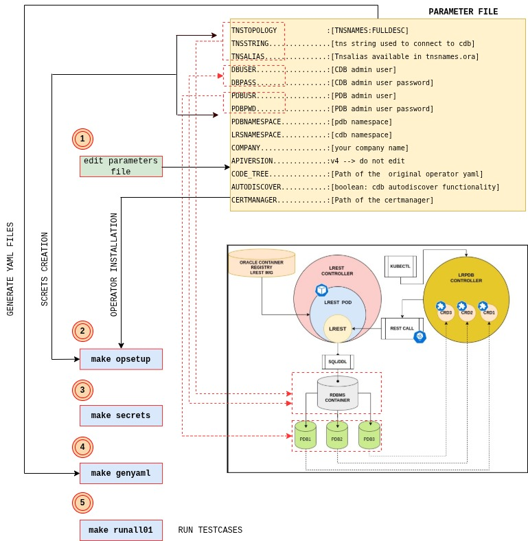

<!-- vscode-markdown-toc -->
1. [Prerequisites](#Prerequisites)
2. [Operator setup](#Operatorsetup)
3. [Secrets creation](#Secretscreation)
4. [YAML file creation](#Yamlfilecreation)
5. [Working with single instance database controller](#Workingwithsingleinstancedatabasecontroller)
6. [Run testcase](#Runtestcase)
7. [Makefile targets table](#Makefiletargetstable)
8. [Diag commands and troubleshooting](#Diagcommandsandtroubleshooting)
   1. [Connect to rest server pod](#Connecttorestserverpod)
   2. [LREST pod log](#Lrestpodlog)
   3. [Monitor control plane](#Monitorcontrolplane)
   4. [CRD details](#Crddetails)

<!-- vscode-markdown-toc-config
	numbering=true
	autoSave=true
	/vscode-markdown-toc-config -->
<!-- /vscode-markdown-toc -->

<span style="font-family:Liberation mono; font-size:0.9em; line-height: 1.1em">

# Use case directory

The use case directory includes a Makefile that automates the installation of the Oracle AI Database Operator using a namespace-scoped configuration and generates the YAML files required to test PDB lifecycle management across two different namespaces (one for the LREST pod and another for the PDB CRD).

To simplify and accelerate the setup process, you only need to update the [parameter file](../usecase/parameters.txt) with the details specific to your environment. The Makefile then uses these parameters to automatically generate all the YAML files needed to test the controllers.

After parameters setup there is the operator installation (**make opsetup**) , the secrets installation (**make secrets**), the yaml file generation (**make genyaml**).



**parameter file table of contents**

```text
TNSTOPOLOGY............:[FULLDESC|TNSNAMES]
USESIDB................:[TRUE|FALSE]
LRESTIMG...............:container-registry.oracle.com/database/operator:lrest_[get the latest]
OPRIMG.................:container-registry.oracle.com/database/operator:latest
TNSSTRING..............:[tnsstring E.G. sidb-sample.sidbnamespace:1521/ORCL1....]
TNSALIAS...............:[tnsalias from tnsnames.ora]
DBUSER.................:[rest dba user]
DBPASS.................:[rest dba p.]
PDBUSR.................:[pdb admin user]
PDBPWD.................:[pdb admin p.]
PDBNAMESPACE...........:[pdb namespace]
LRSNAMESPACE...........:[cdb namespace]
SIDNAMESPACE...........:[sidb namespace]
COMPANY................:oracle
SERVICENAMEACCOUNT.....:default
APIVERSION.............:v4 [leave v4 do not edit]
PLSQLMAP...............:[config map containg plsql]
AUTODISCOVER...........:[TRUE|FALSE]
ORACLE_OPERATOR_YAML...:oracle-database-operator-system.yaml
ORACLE_OPERATOR_RBAC...:oracle-database-operator-rbac.yaml
CODE_TREE..............:[directory where operatore code is cloned (git clone..)]
CERT_MANAGER...........:https://github.com/cert-manager/cert-manager/releases/download/v1.20.2/cert-manager.yaml
OPENSHIFT..............:[TRUE|FALSE]
PASSPROTECTION.........:[NATIVE|OPENSSL3|ORAPKI]
LRESTTRC...............:1
LRPDBTRC...............:128
FILENAMECONVERSION.....:NONE
OCRU...................:[oracle container registry user]
OCRP...................:[oracle container registry p.]

```

> Verify parameters using ``make check`` command. Read doc **[MAKE FILE PARAMETERS](./PARAMETERS.md)** for additional details.

> Read file **[QUICK SETUP EXAMPLE](./QUICK_SETUP.md)** to configure multitenant controller environment:

## 1. <a name='Prerequisites'></a>Prerequisites

* Ensure that **kubectl** is properly installed on your client.
* Even if the makefile automation, read carefully the [operator installation page](../../../../docs/installation/OPERATOR_INSTALLATION_README.md). (role binding,webcert,etc)
* Ensure that the administrative user (admin) on the container database is configured as documented.

eg

```sql
-- Connect to the  container and creates the administrative user 
alter session set "_oracle_script"=true;
create user [DBUSER] identified by [DBPASS];
grant create session to restdba container=all;
grant sysdba to restdba container=all;
```

## 2. <a name='Operatorsetup'></a>Operator setup

```bash
make opsetup
```

The make target **make opsetup** does the following actions:

* Creates a copy the original **oracle-database-operator.yaml** and updates the WATCH_NAMESPACE list with the pdbnamespace and cdbnamespace values.
* [Applies the certmaneger](../../../README.md#install-cert-manager)
* Creates two namespaces: one for the lrest pod and the other one for the pdb controller.
* [Namespace Scoped Deployment](../../../README.md#2-namespace-scoped-deployment)
* Applies the oracle-database-operator.yaml
* [ClusterRole and ClusterRoleBinding for NodePort services](../../../README.md#clusterrole-and-clusterrolebinding-for-nodeport-services)

👉 **If your are running on Openshift you need to manually apply the [service context file](./security_context.yaml)**

## 3. <a name='Secretscreation'></a>Secrets creation

```bash
make secrets
```

**make secrets** creates secrets encrypting the credential specified in the parameters

## 4. <a name='Yamlfilecreation'></a>Yaml file creation

```bash
make genyaml
```

**make genyaml** generates the required `yaml` files to work with multitenant controllers.

## 5. <a name='Workingwithsingleinstancedatabasecontroller'></a>Working with single instance database controller

If an external database is not available to test multitenant controller is possible to leverage on **sidb** controller in order to have a single instance database available on the kubernetes cluster. After operator setup execute the following steps to deploy a sidb.

* edit parameter file; set **USESIDB:TRUE**
* edit parameter file; set **OCRU** and **OCRP** with the [Oracle Container Registry](https://container-registry.oracle.com/) credential. This steps are required to download the Oracle Database Enterprise edition image.  
* run **make sidb**
  * regenerate yaml files
  * create secrets
  * create sidb container with a running database
  * create lrest dba user on the database

## 5. <a name='Runtestcase'></a>Run testcase

```bash
make runall00
```

You can run **make runall00** to test all the functionality the multitenant controller

## 6. <a name='Makefiletargetstable'></a>Makefile targets table

|TARGET          |DESCRIBE                                                              |
|----------------|----------------------------------------------------------------------|
|**opsetup**     | setup the operator                                                   |
|**secrets**     | create secrets for cdb connection                                    |
|**genyaml**     | generate yaml files                                                  |
|createsidb      | create sidb (to use database running on k8s)                         |
|stopsidb        | shutdown sidb instance                                               |
|startsidb       | startup sidb instance                                                |
|tkapplyinit     | config map creation                                                  |
|opclean         | deintall the operator                                                |
|run00           | lrest pod creation                                                   |
|run01.1         | pdb1 creation                                                        |
|run01.2         | pdb2 creation                                                        |
|run02.1         | pdb1 open                                                            |
|run02.2         | pdb2 open                                                            |
|run03.1         | pdb1 clone                                                           |
|run04.1         | pdb1 close                                                           |
|run04.2         | pdb2 close                                                           |
|run05.1         | pdb1 unplug                                                          |
|run06.1         | pdb1 plug                                                            |
|dumplrest       | dump lrest                                                           |
|dumpoperator    | dump operator logs                                                   |
|currimg         | show operator image used                                             |
|check           | print parameters value                                               |
|tklrestnew      | online rest server recreation/https certificate rotation             |
|mgrrestart      | restart manager                                                      |
|listimage       | list images available on the cluster                                 |
|loglrest        | tail -f log lrest                                                    |
|cleanyaml       | clean yaml files                                                     |
|pkg             | tar this directory                                                   |
|run00           | delete and recreate the lrest pod                                    |
|tkautd          | autodiscovery turn on/off *make tkautd AUTOD=false/true*             |
|tkautd01        | test autodiscovery feature
|tkdelcs         | lrest pdb delete cascade (on/off) *make tkdelcs DELETECS=true/false* |
|tkdelcrd        | imperative deletion  *make tkdelcrd DELETECRD=false LRPDNNAME=<crd>* |
|showpdbs        | use sqlplus  in the pod to show pdbs                                 |
|sql             | connect to cdb as sysdba                                             |
|patchstatus     | make patchstatus LRPDBNAME=<pdb> BTMSTS="val1:val2:...:valn"         |
|orapki19        | create orapki db authentication secret (19 syntax)                   |
|orapki26        | create orapki db authentication secret (26 syntax)                   |
|lrestrecreation | delete and recreate lrest pod with to test lrpdb reconnection        |
|appuserct       | create pdb user using secret (negative test)                         |
|appuserct01/02  | create pdb user using secret                                         |
|tkplsqlexec01   | test sql and plsql script creation                                   |
|certverify      | verify https certificate                                             |
|tnsnames        | create tnsnames.ora configmap                                        |
|newpwd          | change restdba password                                              |
|appuserctneg01  | test handle error for malformed appuser secret + rest bitmask status |
|reset01         | reset state  make -f LRPDBNAME=pdb1 RESETSTRING=|PDBCRT|PDBOPN|FNALAZ|
|altercpu        | make  altercpu LRPDBNAME=*lrpdb resource* CPU_COUNT=*cpu count value*|
|open            | make open LRPDBNAME=*lrpdb resource*                                 |
|close           | make close LRPDBNAME=*lrpdb resource*                                |
|opclean         | deintall the operator                                                |
|checkimpdel     | report of imperative delete setting                                  |
|cleanlrest      | drop lrest resource                                                  |
|probetest       | test liveness                                                        |

## 7. <a name='Diagcommandsandtroubleshooting'></a>Diag commands and troubleshooting

### 7.1. <a name='Connecttorestserverpod'></a>Connect to rest server pod

```bash
/usr/bin/kubectl exec   <podname> -n <namespace> -it -- /bin/bash
```

### 7.2. <a name='Lrestpodlog'></a>Lrest pod log

```bash
kubectl logs  `kubectl get pods -o custom-columns=:metadata.name -n cdbnamespace --no-headers ` -n cdbnamespace
```

```bash
## example ##

kubectl get pods -n cdbnamespace
kubectl exec  cdb-dev-lrest-rs-fnw99 -n cdbnamespace -it -- /bin/bash
```

Example output:

```text
NAME                     READY   STATUS    RESTARTS      AGE
cdb-dev-lrest-rs-fnw99   1/1     Running   1 (17h ago)   18h
```

### 7.3. <a name='Monitorcontrolplane'></a>Monitor control plane

```bash
kubectl logs -f -l control-plane=controller-manager -n oracle-database-operator-system
```

```bash
## output example: ##
```

Example output:

```text
2024-10-28T23:54:25Z    INFO    lrpdb-webhook   ValidateUpdate-Validating LRPDB spec for : lrpdb2
2024-10-28T23:54:25Z    INFO    lrpdb-webhook   validateCommon  {"name": "lrpdb2"}
2024-10-28T23:54:25Z    INFO    lrpdb-webhook   Valdiating LRPDB Resource Action : MODIFY
2024-10-29T10:07:34Z    INFO    lrpdb-webhook   ValidateUpdate-Validating LRPDB spec for : lrpdb2
2024-10-29T10:07:34Z    INFO    lrpdb-webhook   ValidateUpdate-Validating LRPDB spec for : lrpdb1
2024-10-29T16:49:15Z    INFO    lrpdb-webhook   ValidateUpdate-Validating LRPDB spec for : lrpdb1
2024-10-29T16:49:15Z    INFO    lrpdb-webhook   validateCommon  {"name": "lrpdb1"}
2024-10-29T16:49:15Z    INFO    lrpdb-webhook   Valdiating LRPDB Resource Action : CREATE
2024-10-29T10:07:20Z    INFO    controller-runtime.certwatcher  Updated current TLS certificate
2024-10-29T10:07:20Z    INFO    controller-runtime.webhook      Serving webhook server  {"host": "", "port": 9443}
2024-10-29T10:07:20Z    INFO    controller-runtime.certwatcher  Starting certificate watcher
I1029 10:07:20.189724       1 leaderelection.go:250] attempting to acquire leader lease oracle-database-operator-system/a9d608ea.oracle.com...
2024-10-29T16:49:15Z    INFO    lrpdb-webhook   Setting default values in LRPDB spec for : lrpdb1
```

### 7.4. <a name='Crddetails'></a>Crd details

Use the **describe** option to obtain `crd` information

```bash
kubectl describe lrpdb lrpdb1 -n pdbnamespace
```

Example output:

```text
[...]
    Secret:
      Key:          e_wbuser.txt
      Secret Name:  wbuser
Status:
  Action:       CREATE
  Bitstat:      25
  Bitstatstr:   |MPAPPL|MPWARN|MPINIT|
  Conn String:  (DESCRIPTION=(CONNECT_TIMEOUT=90)(RETRY_COUNT=30)(RETRY_DELAY=10)(TRANSPORT_CONNECT_TIMEOUT=70)(LOAD_BALLANCE=ON)(ADDRESS=(PROTOCOL=TCP)(HOST=scan12.testrac.com)(PORT=1521)(IP=V4_ONLY))(LOAD_BALLANCE=ON)(ADDRESS=(PROTOCOL=TCP)(HOST=scan34.testrac.com)(PORT=1521)(IP=V4_ONLY))(CONNECT_DATA=(SERVER=DEDICATED)(SERVICE_NAME=pdbdev)))
  Msg:          Success
  Open Mode:    MOUNTED
  Phase:        Ready
  Status:       true
  Total Size:   2G
Events:
  Type     Reason     Age                   From   Message
  ----     ------     ----                  ----   -------
  Normal   Created    108s                  LRPDB  LRPDB 'pdbdev' created successfully
  Normal   Created    108s                  LRPDB  PDB 'pdbdev' assertive pdb deletion turned on
  Warning  LRESTINFO  95s                   LRPDB  pdb=pdbdev:test_invalid_parameter:16:spfile:2065
  Warning  Done       15s (x12 over 2m25s)  LRPDB  cdb-dev
```

</span>
