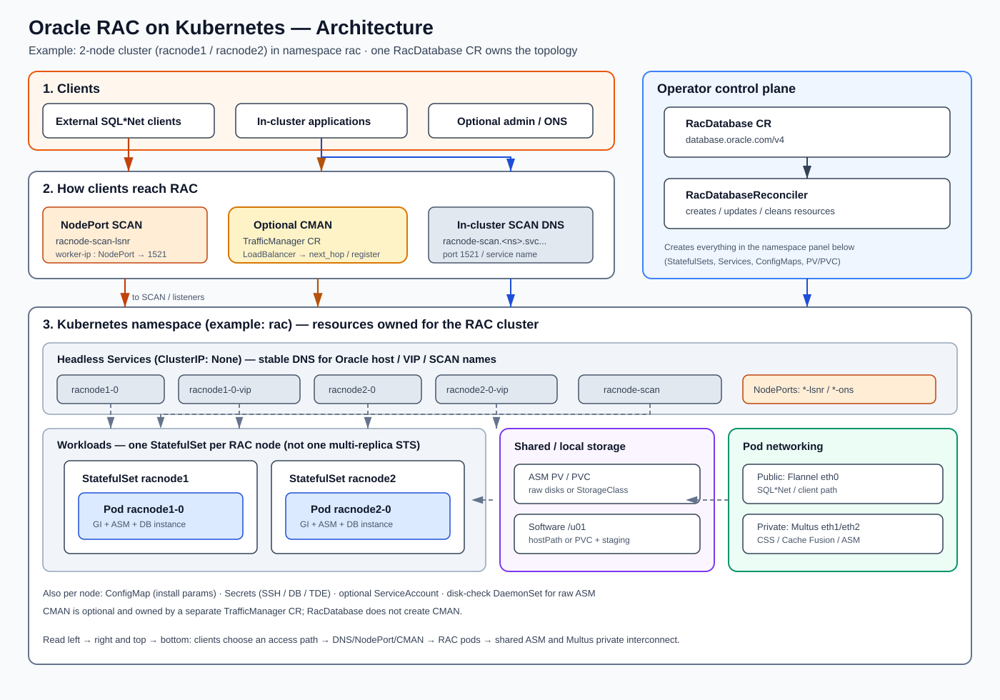

# Oracle RAC on Kubernetes — Architecture

This page explains how the **RacDatabase** controller maps Oracle RAC onto Kubernetes: StatefulSets, headless VIP/SCAN Services, NodePort access, Multus private networking, ASM storage, and optional CMAN.

**API:** `RacDatabase` · `database.oracle.com/v4`  
**Controller:** `RacDatabaseReconciler`  
**Related:** [Connection Manager (CMAN)](../cman/README.md) · [Provisioning guides](./README.md) · [Connectivity](./provisioning/database_connection.md)

---

## Architecture diagram

The diagram below is the full picture for a typical **2-node** deployment (`racNodeName: racnode`, `scanSvcName: racnode-scan`, namespace `rac`). Read it **top to bottom**:

1. **Clients** choose how they connect.
2. **Access paths** (NodePort SCAN, optional CMAN, or in-cluster SCAN DNS) reach the cluster.
3. The **operator** turns one `RacDatabase` CR into namespace resources.
4. Inside the namespace: **headless DNS + NodePorts**, **one StatefulSet per RAC node**, **ASM/software storage**, and **Flannel + Multus** networking.

---

## What the controller supports

| Capability | How it is expressed |
| --- | --- |
| Provision GI + RAC database | One `RacDatabase` CR; Slim image scripts install Grid Infrastructure and the database |
| Multi-node cluster | `spec.instanceDetails.nodeCount`; **one StatefulSet per RAC node** |
| Stable DNS for nodes / VIP / SCAN | Headless Services (`ClusterIP: None`) |
| External SQL\*Net / ONS | Optional NodePort Services for SCAN listener, local listeners, and ONS |
| Scale out / scale in | Increase or decrease `nodeCount` (exclusive operations; controller lock) |
| ASM disk add / remove | `spec.asmDiskGroupDetails` with optional `autoUpdate` |
| Separate CRS and DB disk groups | Multiple ASM disk-group entries (`CRSDG`, `DBDATAFILESDG`, …) |
| RU / one-off patches at provision | `configParams.ruPatchLocation`, `oneOffLocation`, OPatch paths |
| Software storage | Mutually exclusive: hostPath, existing PVC prefix, or StorageClass PVC |
| Staging media | hostPath or PVC for GI/DB zips and patches |
| HugePages, CPU/memory, security context | `resources`, `configParams.hugePages`, `securityContext` |
| Encrypted secrets | DB password and optional TDE wallet secrets |
| Private interconnect | Multus `NetworkAttachmentDefinition` via `privateIPDetails` |
| CMAN front-end | Separate `TrafficManager` CR (not owned by RacDatabase) |

---

## Resource explanations

Sections below describe each part of the diagram. Naming examples use a 2-node cluster with `racNodeName: racnode` and `scanSvcName: racnode-scan`.

### RacDatabase custom resource

Desired state for the whole RAC cluster. The reconciler reads this CR and creates, updates, or deletes the Kubernetes objects below. Status fields such as `connectString`, `pdbConnectString`, `externalConnectString`, `scanDetails`, `racNodes`, and `clientEtcHost` report how the live cluster looks.

### RacDatabaseReconciler

Controller loop that:

1. Validates the spec and acquires an operation lock for exclusive work (scale or ASM change).
2. Syncs Services (headless VIP/local/SCAN and optional NodePorts).
3. Syncs ASM storage (disk-check DaemonSet for raw disks, then PV/PVC).
4. Syncs ConfigMaps and per-node StatefulSets.
5. On scale-in, removes CRS node resources and updates SCAN endpoints (`UpdateScanEP`).

You cannot mix scale-out with scale-in, or ASM disk add with disk delete, in a single update.

### StatefulSets and pods

The controller creates **one StatefulSet per RAC node**, each with a single ordinal pod (`-0`). It does **not** use one StatefulSet with `replicas: N`.

| Object | Example name | Role |
| --- | --- | --- |
| StatefulSet | `racnode1`, `racnode2` | Owns one RAC node |
| Pod | `racnode1-0`, `racnode2-0` | Runs GI + ASM + database instance |
| ConfigMap | Per-node `*cmap` | Install and runtime parameters |

Inside each pod:

- Oracle Grid Infrastructure (Clusterware + ASM)
- Oracle RAC database instance
- Slim-image scripts driven by ConfigMap / env (`SCAN_NAME`, homes, zip names, and so on)
- Privileged networking/ASM capabilities and required sysctls (for example `rp_filter=2`)

Pods are typically pinned to labeled workers with `workerNodeSelector` / affinity.

**Software `/u01` mount** — choose exactly one mode:

| Mode | Spec fields |
| --- | --- |
| hostPath | `instanceDetails.racHostSwLocation` |
| Existing PVC | `racSwPrefix` |
| StorageClass PVC | `swStorageClass` (+ size / `isKeep`) |

Staging of GI/DB media uses either `hostSwStageLocation` or `swStagePvc` + mount path.

### Headless Services (node hostname, VIP, SCAN)

Headless Services (`ClusterIP: None`) provide **stable DNS names** that match Oracle’s host / VIP / SCAN naming. They do not replace CRS VIP ownership inside the pods; they give Clusterware and clients resolvable names in Kubernetes DNS. Services use `publishNotReadyAddresses: true` so peers can resolve during bring-up.

| Service | Example name | Selector | Example FQDN | Oracle use |
| --- | --- | --- | --- | --- |
| Local hostname | `racnode1-0` | That pod only | `racnode1-0.rac.svc.cluster.local` | Node public hostname |
| VIP hostname | `racnode1-0-vip` | That pod only | `racnode1-0-vip.rac.svc.cluster.local` | Node VIP name for listeners |
| SCAN | `racnode-scan` | All RAC-labeled pods | `racnode-scan.rac.svc.cluster.local` | Single Client Access Name |

**VIP note:** The Kubernetes VIP Service stays pinned to its pod. CRS may manage VIP listeners inside Oracle; the Service selector does not follow CRS VIP relocation across nodes.

**SCAN note:** After scale-in, the controller updates SCAN endpoints in Grid Infrastructure on a healthy remaining node.

### NodePort Services (external access)

When `scanSvcTargetPort` and base listener/ONS ports are set, the controller also creates NodePort Services so clients outside the cluster can reach SCAN, local listeners, and ONS through worker-node IPs.

| Service | Example name | Typical mapping | Purpose |
| --- | --- | --- | --- |
| SCAN listener | `racnode-scan-lsnr` | `1521:31521/TCP` | External SCAN SQL\*Net |
| Local listener | `racnodeN-0-lsnr` | `baseLsnrTargetPort + index` | Direct instance connect |
| ONS | `racnodeN-0-ons` | target `6200`, NodePort from `baseOnsTargetPort` | Fast Application Notification |

External clients often map worker public IPs in `/etc/hosts` for `racnode-scan` and node hostnames, then connect with Easy Connect. See [database_connection.md](./provisioning/database_connection.md).

> **LoadBalancer for RAC listeners:** `spec.externalSvcType` exists on the CR, but current builders expose SCAN/listener/ONS as **NodePort**. For a cloud LoadBalancer front door, use **ConnectionManager (CMAN)**.

### Networking (Flannel public + Multus private)

Oracle Clusterware needs at least two networks. On OCNE the documented pattern is:

| Network | Mechanism | Pod interface | Used for |
| --- | --- | --- | --- |
| Public | Default CNI (Flannel) | `eth0` | Client SQL\*Net, Kubernetes DNS |
| Private interconnect | Multus NAD (`macvlan` / `ipvlan`) | `eth1` / `eth2` | CSS, Cache Fusion, ASM heartbeats |

The controller reads Multus NAD IPAM, assigns `rangeStart + nodeIndex` (IPv4), and annotates pods with `k8s.v1.cni.cncf.io/networks`. Apply Multus RBAC before provision (`rbac/multus-rbac.yaml`). Details: [Prerequisites](./provisioning/prerequisites_oracle_rac_db.md).

### Storage (ASM disks and software)

| Concern | Behavior |
| --- | --- |
| Raw shared disks | Disk-check DaemonSet validates sizes; controller creates local PV + PVC and mounts devices into pods |
| StorageClass ASM | Per-disk PVC sized by `asmStorageSizeInGb` |
| Disk groups | CRS vs data/recovery/redo/others; independent redundancy |
| Add disks | Spec change; optional `autoUpdate` into ASM |
| Delete disks | Only unused disks; cannot add and remove in the same reconcile |
| Retain volumes | `isKeep` / topology delete flags control cleanup |

Software and staging options are listed under [StatefulSets and pods](#statefulsets-and-pods).

### Optional CMAN (ConnectionManager)

CMAN is **not** created by `RacDatabase`. Deploy a separate [`ConnectionManager`](../cman/README.md) (`network.oracle.com/v4`) that fronts the RAC SCAN Service. Do not create new `TrafficManager` resources with `spec.type: cman`.

| Pattern | Sample | `remote_listener` on RAC? |
| --- | --- | --- |
| Generated rules; RAC registers with CMAN | [`cman-rac.yaml`](../trafficmanager/samples/cman-rac.yaml) | **Yes** — include CMAN, then `ALTER SYSTEM REGISTER` on each instance |
| File-mode global `next_hop` to SCAN | [`cman-rac-nexthop.yaml`](../trafficmanager/samples/cman-rac-nexthop.yaml) | **No** — CMAN forwards to `racnode-scan` |

Typical next-hop target: `racnode-scan.rac.svc.cluster.local:1521`.

### Secrets and ServiceAccount

| Object | Role |
| --- | --- |
| SSH key secret | Passwordless access between RAC pods during install / scale |
| DB password secret | SYS and related credentials (optionally encrypted) |
| TDE wallet secret | Optional wallet password material |
| ServiceAccount | Optional; used when Multus/PV RBAC or custom SA is required |

---

## Client connectivity paths

| Path | When to use | Typical connect string |
| --- | --- | --- |
| In-cluster SCAN | Apps inside the same Kubernetes cluster | `//racnode-scan.rac.svc.cluster.local:1521/soepdb` |
| NodePort SCAN | External clients; no CMAN | `//<worker-ip>:31521/soepdb` |
| CMAN LoadBalancer | External clients through ConnectionManager | `//<cman-external-ip>:1521/soepdb` |
| Local listener NodePort | Direct instance connect / debugging | `//<worker-ip>:31522/soepdb` |

Status on the CR often publishes `connectString`, `pdbConnectString`, and `externalConnectString` after the cluster is available.

---

## Oracle concept to Kubernetes mapping

| Oracle RAC concept | Kubernetes representation |
| --- | --- |
| RAC cluster desired state | `RacDatabase` CR |
| Cluster node / GI host | StatefulSet + Pod `racnodeN-0` |
| Public hostname | Headless Service `racnodeN-0` |
| Node VIP name | Headless Service `racnodeN-0-vip` |
| SCAN name | Headless Service `spec.scanSvcName` |
| SCAN / local / ONS listeners (external) | NodePort Services |
| Private interconnect | Multus secondary NICs |
| Shared ASM disks | PV/PVC (raw or StorageClass) |
| ORACLE_HOME / GI home on disk | hostPath or PVC under `/u01` |
| DB / PDB service attributes | `spec.serviceDetails` |
| Connection Manager | `ConnectionManager` (separate CR) |

---

## Related documentation

| Topic | Link |
| --- | --- |
| RAC docs hub and use-case list | [README.md](./README.md) |
| Prerequisites (OCNE, Multus, disks, labels) | [prerequisites_oracle_rac_db.md](./provisioning/prerequisites_oracle_rac_db.md) |
| QuickStart | [QUICKSTART.md](./provisioning/QUICKSTART.md) |
| Spec field reference | [ENVVARIABLES.md](./provisioning/ENVVARIABLES.md) |
| Connectivity examples | [database_connection.md](./provisioning/database_connection.md) |
| CMAN / ConnectionManager | [../cman/README.md](../cman/README.md) |
| Known issues | [known_issues.md](./provisioning/known_issues.md) |
